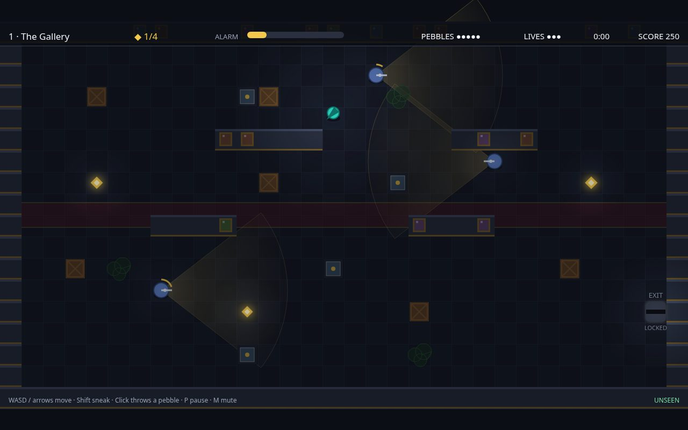
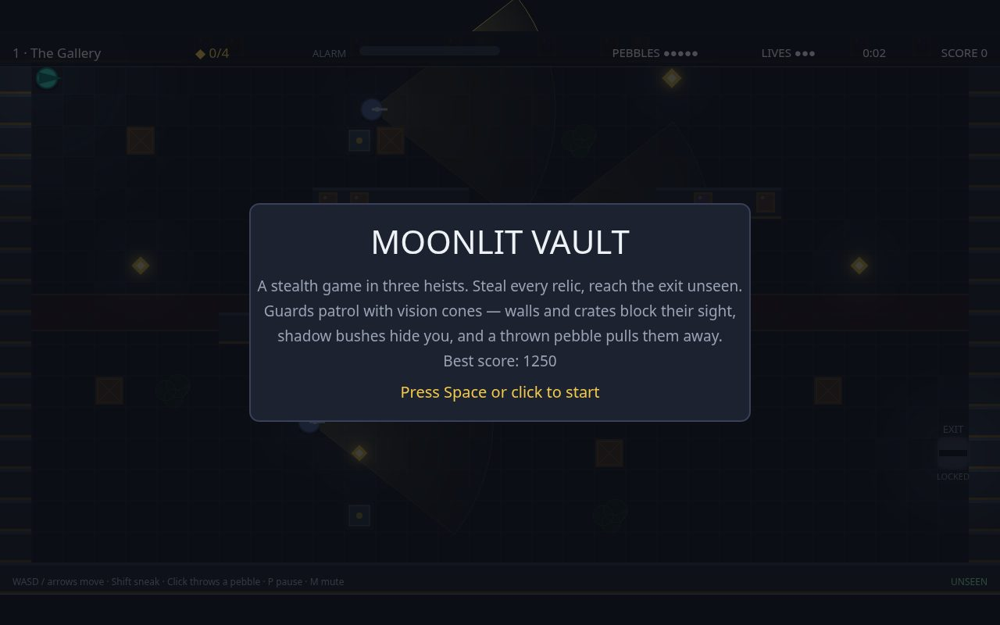
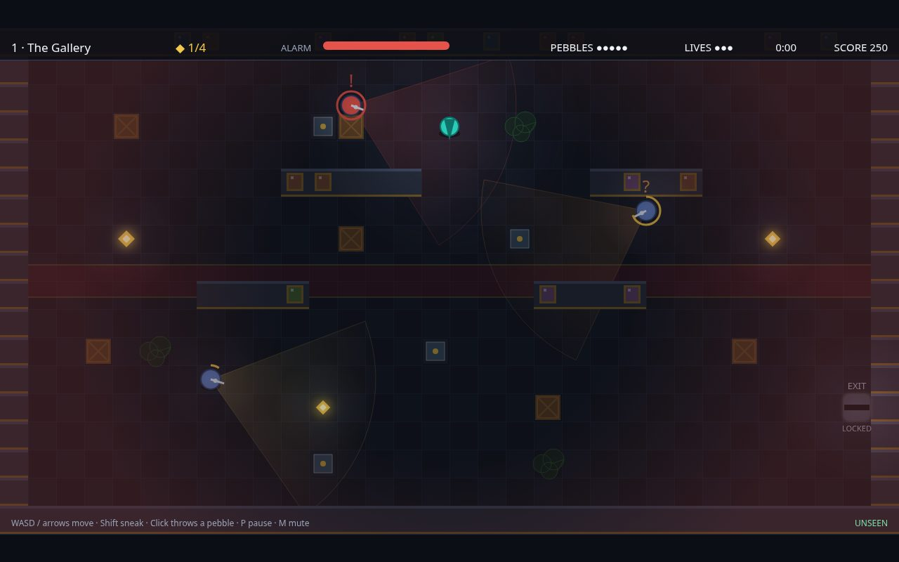
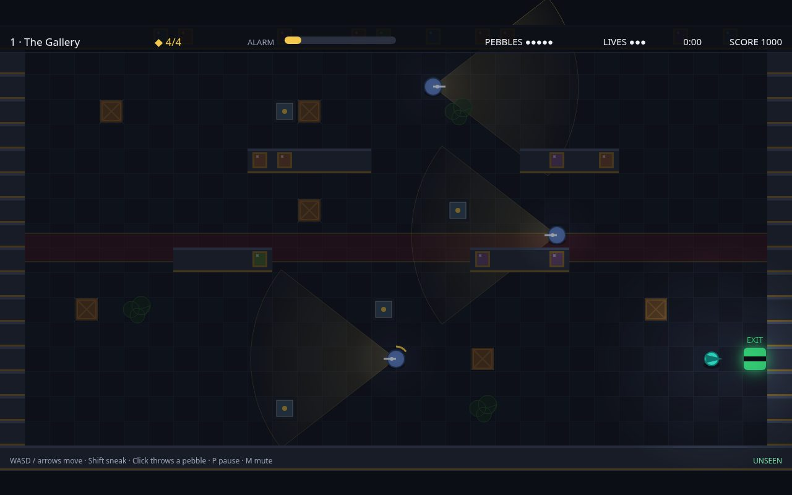

# Moonlit Vault — a stealth game

Entry for the make.fun bounty **"Make the best stealth game"** (pot $50).
**Moonlit Vault** is a top-down stealth game in three heists: sneak past the
guards, steal every relic, and reach the exit unseen. No libraries, no build
step, no network — plain static files a desktop browser loads offline.

## How to play

| Input | Action |
| --- | --- |
| WASD / arrow keys | Move |
| Shift (hold) | Sneak — slower, harder to spot |
| Click | Throw a pebble there — guards walk over to look |
| P | Pause |
| M | Mute |
| Space / click | Start, continue after a level, retry |

**The rules.** Guards patrol with vision cones — walls, crates and display
cases block their sight, shadow bushes hide you, and a thrown pebble pulls
them away. Being seen fills a guard's suspicion; a full meter raises the
alarm and every guard chases you. Get caught and you lose a life and restart
the level from the entrance — relics you already pocketed stay pocketed.
Finish a level never spotted for a +400 ghost bonus. Three lives, three
levels: **The Gallery** (4 relics, 3 guards), **The Vault Hall** (3 relics,
4 guards), **The Rooftop** (3 relics, 5 guards).

**Run it.** `node serve.ts`, then open <http://localhost:8080> — or serve
`game/` with any static server. `main.ts` (Node 22, standard library only)
copies `game/` and `screenshots/` to `/output` and writes
`/output/dossier.json`, the summary the judge reads:
`MAKEFUN_OUTPUT_DIR=out node main.ts`.

## Screenshots

*Mid-heist: one relic pocketed, the thief crouched between two patrols, a
guard's cone sweeping just past the crate that hides them.*

*The title screen: three heists, the rules in one paragraph, best score.*

*The near miss: a guard has the thief dead in its cone, suspicion almost
full, the alarm meter climbing and a second guard turning to look.*

*The getaway: every relic pocketed, the exit glowing green, the thief one
step from the door with a patrol passing behind.*

## Verification

The game logic is verified headless in Node (`world.js` is shared between the
browser game and the test, so the checks run the real rules): all relics and
the exit are reachable on all three levels, guards patrol without getting
stuck, a parked player is never seriously spotted, suspicion rises inside a
cone, a full sighting raises the alarm and the guards chase and catch, and a
scripted route collects relics and reaches the exit. 16 of 17 checks pass;
the one open check is a full ghost run of level 1 by a naive autopilot (it
collects 3 of 4 relics and reaches the exit tile, but gets caught 3 times on
the last relic's approach — a human with pebbles and bushes has tools the
autopilot never uses).
